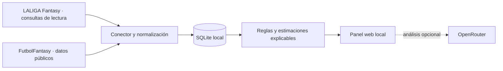

<div align="center">
  <h1>⚽ Agente Fantasy</h1>
  <p><strong>Decisiones más claras para hacer crecer tu equipo de LALIGA Fantasy.</strong></p>
  <p>Un asesor local que reúne plantilla, mercado, actividad de liga y referencias de FutbolFantasy en un panel explicable y de solo lectura.</p>

  <p>
    <a href="https://github.com/tavoidkk/agente-fantasy"></a>
    
    
    
  </p>
  <p><sub>En desarrollo · independiente y no afiliado a LALIGA ni a FutbolFantasy.</sub></p>
</div>

<br />

## Contenido

- [Qué es](#qué-es-agente-fantasy)
- [Qué puedes hacer](#qué-puedes-hacer)
- [Cómo funciona](#cómo-funciona)
- [Inicio local](#inicio-local)
- [Comandos](#comandos)
- [Fuentes y recomendaciones](#fuentes-y-recomendaciones)
- [Privacidad y seguridad](#privacidad-y-seguridad)
- [Estado y límites](#estado-y-límites)
- [Resolución de problemas](#resolución-de-problemas)

## Qué es Agente Fantasy

Agente Fantasy ayuda a administrar una liga de LALIGA Fantasy con información reunida en un único panel. Su objetivo es **aumentar el valor y la competitividad de tu plantilla**: compara precios, tendencias, rendimiento, actividad visible y necesidades del once para que puedas decidir con más contexto.

La aplicación se ejecuta en tu ordenador. Las recomendaciones explican los datos que las sustentan y mantienen separadas las observaciones de las estimaciones. **No hace pujas, ventas, clausulazos ni cambios en el juego.**

## Qué puedes hacer

| Área | Funcionalidad |
| --- | --- |
| **Panel** | Resumen de tu equipo, posición, valor, puntos, mercado y últimos movimientos. |
| **Constructor de alineación** | Organiza tu XI por formación, compara las métricas disponibles y guarda un borrador local. |
| **Mercado** | Consulta jugadores libres y puestos en venta por managers, con precio, tendencia y rango orientativo de puja. |
| **Rivales** | Revisa plantillas, cláusulas visibles, tendencias de precio y operaciones de actividad atribuibles cuando existen. |
| **Partidos y posibles onces** | Explora encuentros y alineaciones probables de FutbolFantasy, con probabilidad y datos disponibles por jugador. |
| **Ficha e historial** | Consulta referencias de precio, variaciones e historial local recopilado por la aplicación. |
| **Favoritos y búsqueda** | Sigue jugadores en este navegador y busca jugadores, clubes o managers dentro de la liga. |
| **IA opcional** | Configura OpenRouter desde la interfaz para obtener propuestas explicables. La aplicación funciona también sin IA. |

## Cómo funciona



- **LALIGA Fantasy** aporta la información privada de la liga disponible para la cuenta conectada.
- **FutbolFantasy** aporta referencias públicas de precios, variaciones y posibles alineaciones.
- **SQLite** conserva observaciones para acelerar consultas y formar un historial local.
- **OpenRouter es opcional**. Solo se envía al proveedor la selección de datos necesaria para el análisis; el token OAuth de LALIGA no se incluye en esa solicitud.

## Inicio local

### Requisitos

- Windows 10/11 recomendado.
- Python 3.11 o posterior.
- Conexión a internet para actualizar LALIGA Fantasy y FutbolFantasy.
- Una sesión de LALIGA Fantasy. La conexión se realiza mediante el flujo OAuth local; no entregues tu contraseña a la aplicación.
- Opcional: una clave de OpenRouter para las recomendaciones asistidas por IA.

### Instalar y abrir

Abre PowerShell en la carpeta del repositorio:

```powershell
py -3.11 -m venv .venv
.\.venv\Scripts\Activate.ps1
python -m pip install --upgrade pip
python -m pip install -e .
fantasy-advisor web
```

Abre [http://127.0.0.1:8765](http://127.0.0.1:8765). Desde **Conectar**, completa el acceso en la página oficial de LALIGA y selecciona la liga. La URL de retorno OAuth puede incluir un código temporal: no la publiques ni la compartas.

Para actualizar precios y posibles alineaciones desde la terminal:

```powershell
fantasy-advisor sync --prices-only
```

Detén el servidor con `Ctrl+C` en la terminal.

## Comandos

| Comando | Uso |
| --- | --- |
| `fantasy-advisor web` | Inicia el panel web local. |
| `fantasy-advisor connect` | Conecta la cuenta y permite seleccionar liga. |
| `fantasy-advisor status` | Muestra el estado de conexión y sincronización. |
| `fantasy-advisor sync` | Actualiza precios y posibles alineaciones. |
| `fantasy-advisor sync --prices-only` | Actualiza solo precios. |
| `fantasy-advisor sync --force` | Fuerza una sincronización sin usar la caché. |
| `fantasy-advisor league` | Consulta plantilla, saldo propio y rivales. |
| `fantasy-advisor recommend` | Genera recomendaciones de solo lectura. |
| `fantasy-advisor prices "nombre"` | Busca precio e historial de un jugador. |
| `fantasy-advisor disconnect` | Quita la sesión guardada en este ordenador. |

Consulta `fantasy-advisor --help` para ver la ayuda completa.

## Fuentes y recomendaciones

La API de LALIGA usada por el conector **no es oficial ni está documentada públicamente** y puede cambiar. FutbolFantasy se consulta desde sus páginas públicas. El conector de FutbolFantasy respeta `robots.txt`, usa caché y limita la frecuencia de solicitudes.

Los rangos de puja se basan en importes de actividad que pueden compararse con una observación **fechada del valor de mercado de LALIGA**. Cuando hay suficientes operaciones comparables se priorizan por posición o tramo de precio; con menos datos la confianza baja. Si no existe una referencia verificable, el sistema no inventa un porcentaje de sobreprecio y mantiene el objetivo en el precio mínimo disponible.

La actividad no revela las pujas privadas. Tampoco confirma siempre quién compró o vendió, así que no equivale a un registro completo de precios ganadores. El rango es una estimación para apoyar tu decisión, no una garantía de ganar una puja.

La base local se encuentra en:

```text
%LOCALAPPDATA%\LaligaFantasyAdvisor\advisor.sqlite3
```

El historial local empieza cuando la aplicación comienza a guardar observaciones; no puede reconstruir datos que nunca se capturaron.

## Privacidad y seguridad

- La interfaz escucha en `127.0.0.1`; no la publiques directamente en internet.
- Los tokens OAuth y la clave opcional de OpenRouter se guardan mediante `keyring` en el almacén de credenciales del sistema, no en este repositorio ni en SQLite.
- No subas contraseñas, códigos OAuth, tokens, claves API, archivos locales de datos o capturas con información de tu liga.
- Los borradores de alineación y favoritos son locales; no cambian tu equipo ni tus favoritos dentro del juego.
- La aplicación es de solo lectura respecto a LALIGA Fantasy y requiere que confirmes cualquier acción directamente en el juego.

## Estado y límites

Este proyecto está en desarrollo. El formato de la API puede variar y los datos de FutbolFantasy pueden no identificar a todos los jugadores automáticamente. Si un jugador no se reconoce, revisa la sincronización y la ficha antes de basar una decisión en esa referencia.

Las cláusulas, bloqueos, valores y probables reflejan la última respuesta disponible, no una garantía de que sigan iguales al abrir el juego. Comprueba siempre las condiciones actuales antes de actuar.

## Resolución de problemas

| Problema | Qué revisar |
| --- | --- |
| La liga no aparece | Ejecuta `fantasy-advisor connect` y vuelve a seleccionarla. |
| El acceso OAuth no vuelve automáticamente | Copia la URL completa de retorno indicada por la aplicación en su terminal local; no la publiques. |
| No se actualizan los precios | Ejecuta `fantasy-advisor sync --prices-only` y revisa la fecha de actualización. |
| Un movimiento no muestra jugador | Actualiza el panel para volver a leer la actividad y el catálogo de jugadores de la API. |
| La IA no responde | Revisa la clave y el modelo desde Ajustes. La disponibilidad de modelos gratuitos puede cambiar. |
| Windows no guarda credenciales | Comprueba que el entorno Python tenga un backend de `keyring` disponible. |

## Estructura del proyecto

```text
src/fantasy_advisor/
├── advisor.py       # Reglas para la alineación y el mercado
├── auth.py          # OAuth local y credenciales del sistema
├── decisions.py     # Rangos de puja y estimación de compra
├── sources/         # Conectores de LALIGA Fantasy y FutbolFantasy
├── storage.py       # Historial local y configuración SQLite
├── web.py           # Servidor local y API de la interfaz
└── web/             # HTML, estilos y JavaScript del panel
docs/                # Arquitectura y fuentes de datos
tests/               # Pruebas automatizadas del proyecto
```

## Licencia

El repositorio aún no define una licencia. Hasta que se añada una, no se concede permiso explícito para reutilizar o redistribuir el código.
